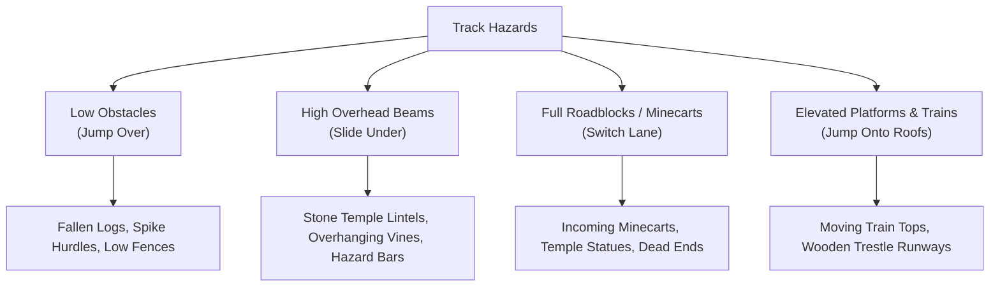
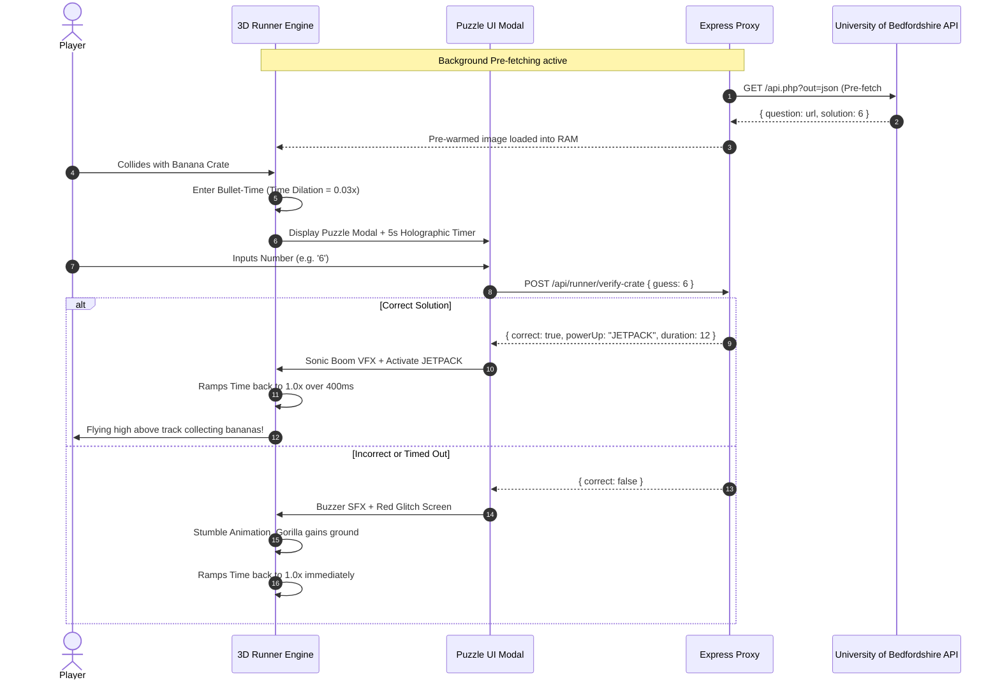
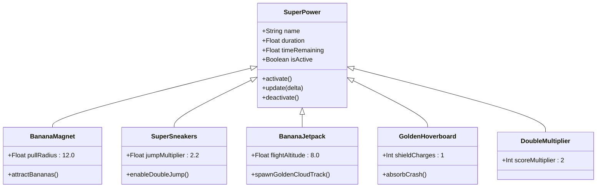
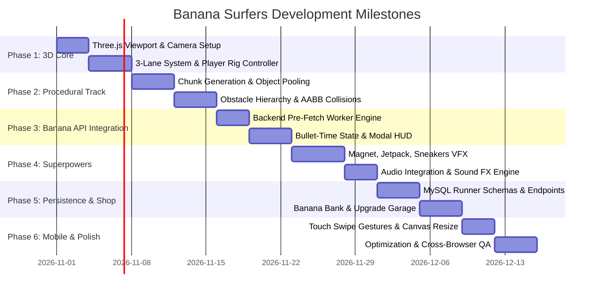

# Banana Surfers: Brain Quest Runner
## Technical Project Plan & System Architecture

> **Author / Architect:** Google Antigravity Agent  
> **Target Framework:** Modern Web (Three.js WebGL / Node.js Express / MySQL)  
> **API Integration:** University of Bedfordshire Banana API (`marcconrad.com/uob/banana/api.php`)  
> **Game Archetype:** Fast-Paced 3D Endless Runner (Reference: *Subway Surfers*)  
> **Document Status:** Complete Architectural Specification  

---

## 1. Executive Summary & Vision

### 1.1 The Concept
**Banana Surfers: Brain Quest Runner** is a 3D, browser-based endless runner inspired directly by *Subway Surfers*, infusing high-octane 3-lane dodging mechanics with rapid-fire mathematical agility powered by the **University of Bedfordshire Banana API**.

The player assumes the role of an agile runner dashing through vibrant jungle temple tracks and canopy railways, dodging moving minecarts, ducking beneath ancient stone lintels, and leaping across broken rail sections. Scattered along the tracks are **Banana Mystery Crates**. 

Collecting a crate triggers an immediate, seamless **Bullet-Time Puzzle Interruption**: time slows to a crawl, presenting a visual puzzle from the University of Bedfordshire Banana API. If the runner inputs the correct single-digit solution within a strict 5-second countdown, the puzzle shatters with a sonic boom, instantly bestowing a high-tier *Subway Surfers*-style **Super Power** (such as the *Banana Magnet*, *Sky Jetpack*, *Super Sneakers*, *2x Multiplier*, or *Golden Shield Board*).

### 1.2 Target Experience Goals
* **Sub-Zero Input Latency:** 60 FPS minimum on modern desktop and mobile browsers via WebGL (Three.js).
* **Frictionless Puzzle Integration:** Zero network stutter when opening crates via server-side pre-fetching and background queueing.
* **Balanced Dual-Pacing:** Harmonizing the reflex-driven rush of endless running with micro-bursts of cognitive puzzle solving.
* **Seamless Extensibility:** Fully compatible with the existing `bananaApi` / `banana-brain-ques` backend authentication, MySQL database, and session architecture.

---

## 2. University of Bedfordshire Banana API Research

### 2.1 Background & Origin
The **Banana API** was created and maintained by **Dr. Marc Conrad** at the **University of Bedfordshire** (Department of Computer Science and Technology). Originally engineered for academic exercises, web services coursework, and interactive game development, it serves as a lightweight, reliable puzzle generation service.

* **Base Endpoint:** `http://marcconrad.com/uob/banana/api.php`
* **Protocol & Domain:** HTTP on `marcconrad.com` with puzzle image hosting routed through `www.sanfoh.com/uob/banana/data/`.

### 2.2 Endpoint Parameters & Response Payloads

| Query Parameter | Type | Default | Description |
| :--- | :--- | :--- | :--- |
| `out` | `string` | `json` | Output serialization format (`json`, `xml`, or `csv`). |
| `base64` | `string` | `no` | When set to `yes`, embeds the raw PNG as a base64 Data URI instead of a URL link. |

#### Sample JSON Response
```json
{
  "question": "https://www.sanfoh.com/uob/banana/data/t8deb6fc816fc504ad1584d8e6an50.png",
  "solution": 7
}
```

### 2.3 Puzzle Nature & Mathematical Characteristics
1. **Visual Equation Algebra:** Each generated image contains a 3-tier visual equation featuring banana bunches, fruits, or character icons.
2. **Discrete Solution Range:** Solutions are almost exclusively single integers from **0 to 9**. This is a crucial game-design advantage: it enables a tactile 10-key numpad interface or instantaneous on-screen numpad buttons without requiring alphanumeric typing.
3. **Deterministic Image Encoding:** Each puzzle is dynamically rendered or indexed via unique hash keys (e.g., `t8deb...an50.png`), ensuring unique puzzles across runs.

### 2.4 Critical Technical Constraints & Architectural Solutions

> [!WARNING]
> **Mixed-Content & Security Vulnerabilities:**
> 1. **Mixed Content Blocking:** The Banana API operates over standard HTTP (`http://marcconrad.com/...`). Browsers served over HTTPS will block direct client-side fetch requests due to modern Mixed Content Security Policies.
> 2. **Client-Side Answer Tampering:** If the client calls the UoB API directly, the JSON payload exposes the plain-text `solution` property in DevTools network logs, allowing cheating.
> 3. **Network Latency Spikes:** Live network roundtrips to an external server take between 120ms to 450ms. Calling the API *at the exact moment* a crate is collected causes a jarring hitch in a 60 FPS endless runner.

#### Mitigation Architecture: The Pre-Fetching Reverse Proxy
To completely neutralize these constraints, the backend Express application implements a **FIFO Pre-Warming Cache Queue** per active runner session:
* The backend continuously maintains a buffer of 2 pre-fetched puzzles per active runner.
* The backend strips the `solution` property before sending the puzzle payload to the client, storing the solution in a hashed server-side session dictionary (`session.activeCratePuzzle = { puzzleId, solution, expiresAt }`).
* When the runner hits a crate, the puzzle image is **already loaded in browser memory**, guaranteeing **0ms delay**.

```
[University of Bedfordshire API]
             │ (HTTP Background Fetch)
             ▼
[Express Server: /api/runner/crate-queue]
   ├── Strips "solution"
   ├── Stores { puzzleId, solution } in Session
   └── Serves { puzzleId, imageUrl } to Client
             │ (Pre-cached via Image())
             ▼
[Browser Three.js Runner: 0ms Modal Trigger]
```

---

## 3. Game Design & Core Mechanics (Subway Surfers Mapping)

### 3.1 Movement & The 3-Lane Grid System
Following the battle-tested conventions of *Subway Surfers*, the playable world is constrained to three parallel lanes:

```
    LANE -1 (LEFT)       LANE 0 (CENTER)      LANE +1 (RIGHT)
   [ -2.5 world units ] [ 0.0 world units ] [ +2.5 world units ]
         │                     │                     │
         │         [Player]    │                     │
         ▼                     ▼                     ▼
=============================================================
```

* **Lane Snapping & Interpolation:** Horizontal transitions do not instantly teleport the runner. Instead, they use a snappy cubic ease-out lerp (`speed = 14.0 units/sec`) with a slight roll/tilt of the character model ($12^\circ$) toward the direction of the switch.
* **Jumping & Gravity:** 
  - Standard Jump Height: 2.8 units.
  - Air time: 0.65 seconds (custom parabolic arc $y = v_0 t - \frac{1}{2} g t^2$).
  - Players can execute a "Fast Fall / Dive" by swiping down while airborne to immediately return to the track.
* **Rolling / Sliding:**
  - Sliding reduces the character's collision bounding box by 60% for 0.8 seconds.
  - Enables sliding under high stone gates, log barriers, and fallen temple pillars.

### 3.2 Controls Matrix

| Action | Desktop Keyboard | Mobile Touchscreen / Swipe | Controller / Gamepad |
| :--- | :--- | :--- | :--- |
| **Move Left** | `A` or `←` Arrow | Swipe Left | D-Pad Left / Left Stick Left |
| **Move Right** | `D` or `→` Arrow | Swipe Right | D-Pad Right / Left Stick Right |
| **Jump** | `W` or `↑` Arrow or `Space` | Swipe Up | Button A / D-Pad Up |
| **Roll / Slide** | `S` or `↓` Arrow | Swipe Down | Button B / D-Pad Down |
| **Fast Fall** | `S` or `↓` Arrow (in air) | Swipe Down (in air) | Button B (in air) |
| **Deploy Hoverboard**| Double-tap `Space` | Double-Tap Screen | Button X / Trigger |
| **Solve Puzzle** | Keys `0` - `9` | On-Screen Numpad Grid | Face Buttons / Virtual Pad |

### 3.3 Obstacles & Hazard Classification



### 3.4 Dynamic Difficulty & Speed Curve
The forward speed $v(t)$ scales continuously as distance increases, using a logarithmic progression that starts comfortably and becomes blistering:

$$v(t) = v_{\text{base}} + \Delta v_{\text{max}} \cdot \left( \frac{\ln(1 + k \cdot t)}{\ln(1 + k \cdot t_{\text{cap}})} \right)$$

* $v_{\text{base}} = 15\text{ m/s}$ (Early game, forgiving reaction windows).
* $v_{\text{max}} = 38\text{ m/s}$ (High-tier speed cap reached around 2,500 meters).
* Obstacle frequency and combination difficulty (e.g., Jump followed immediately by Lane Switch) increase every 500 meters.

### 3.5 The Chaser Mechanic (The Inspector & Dog Equivalent)
* **The Jungle Gorilla Warden:** Whenever the runner stumbles (grazing a side obstacle without a head-on collision), the Gorilla Warden enters the camera frame from behind, snapping at the player's heels.
* **Recovery Window:** The player has 5 seconds of error-free running to shake the chaser off. A second stumble within this window results in a capture cutscene and immediate Game Over.

---

## 4. Banana Mystery Crate & Puzzle Mechanics

### 4.1 Spawning & Placement
* **Spawn Frequency:** Crates appear every 350–500 meters along the track.
* **Risk/Reward Placement:** Crates never sit idly on an empty track. They are placed:
  * Suspended in the air above a jump barrier.
  * Tucked underneath a sliding gate.
  * Centered on the roof of a fast-moving minecart.
  * Flanked on both sides by oncoming obstacles.

```
       [High Barrier]
            ║
 [Track]────╨───────[BANANA CRATE]────────[Obstacle]───
                       ▲ (Slide Under & Grab)
```

### 4.2 The Puzzle Interaction: "Bullet-Time Hyper-Slow"
To preserve the adrenaline of the runner without causing disorientation, crate collection triggers a custom **Bullet-Time State Machine**:



### 4.3 Input Modalities for Rapid Puzzle Solving
Because solving must occur in under 5 seconds:
* **Desktop:** The player presses any number key `0` through `9` on their physical keyboard or numpad.
* **Mobile / Touch:** A semi-transparent $3 \times 4$ arcade keypad illuminates on the bottom third of the screen, with large, finger-friendly hit targets (numbers 0 to 9, Clear, and Submit).
* **Instant Validation:** Inputting a single digit automatically triggers verification; no "Press Enter" is required, maximizing speed and excitement.

---

## 5. Super Power & Progression Systems

When a puzzle is successfully solved, the game randomly grants (or selects based on crate rarity) one of five iconic super powers inspired by *Subway Surfers*:



### 5.1 The Super Power Roster

#### 1. The Banana Magnet (Subway Surfers Coin Magnet)
* **Mechanic:** Generates an electromagnetic banana vortex around the runner.
* **Effect:** Bananas from all three lanes smoothly curve toward the player using cubic Bézier splines, regardless of which lane the runner occupies.
* **Base Duration:** 12 seconds.
* **Visuals:** Pulsing golden magnetic rings around the runner's waist with yellow streak trails.

#### 2. Super Sneakers (Subway Surfers Super Sneakers)
* **Mechanic:** Multiplies the runner's jump impulse by $2.2\times$.
* **Effect:** Allows the player to clear entire train cars, leap over multi-barrier sequences, and access high elevated runways.
* **Base Duration:** 15 seconds.
* **Visuals:** Bouncing spring particles beneath the runner's feet with high-pitched cartoon boing audio.

#### 3. Banana Jetpack (Subway Surfers Jetpack)
* **Mechanic:** Launches the runner vertically into the cloud layer above all hazards.
* **Effect:** Completely removes all ground obstacles. Replaces the track with three dense, winding lanes of golden bananas. The player cannot crash while airborne. When the timer expires, the jetpack cuts out, and a small banana parachute gently glides the runner down onto a guaranteed clear lane.
* **Base Duration:** 10 seconds.
* **Visuals:** Twin thrusters on the runner's back spraying banana peel sparks and smoke ribbons.

#### 4. The Golden Hoverboard (Crash Shield & Multi-Life)
* **Mechanic:** Provides single-hit crash immunity.
* **Effect:** If the player collides with any obstacle (minecart, hurdle, wall) while the hoverboard is active, the board detonates in a golden shockwave, destroying all obstacles within 20 meters. The runner keeps running at full speed without losing a life.
* **Duration:** 30 seconds or until consumed by a collision.
* **Visuals:** Sleek floating surfboard beneath the character with neon underglow.

#### 5. 2x Brain Multiplier (Subway Surfers 2x Multiplier)
* **Mechanic:** Doubles all score accrual from distance run and bananas collected.
* **Effect:** Stacks multiplicatively with user difficulty multipliers (e.g., Extra Hard base $2.0\times$ becomes $4.0\times$).
* **Base Duration:** 20 seconds.
* **Visuals:** Floating glowing `x2` icon above the runner's head with a pulsing chromatic aberration filter.

---

## 6. Technology Stack & Engine Evaluation

### 6.1 Frontend 3D Engine Comparison

| Engine / Library | Bundle Size | Render Tech | 3D Depth & Physics | Mobile Web Perf | Recommendation Score |
| :--- | :--- | :--- | :--- | :--- | :--- |
| **Three.js + Cannon-es / OBB** | ~160 KB (gzipped) | WebGL 2.0 / WebGPU ready | Exceptional 3D perspective, glTF models, custom shaders | 60 FPS rock-solid | **9.8/10 (Recommended)** |
| **Babylon.js** | ~800 KB (gzipped) | WebGL 2.0 / WebGPU | Full-featured AAA engine, built-in Havok physics | 50–60 FPS, higher memory footprint | **8.2/10** |
| **Phaser 3 (2.5D Mode-7)** | ~220 KB (gzipped) | Canvas / 2D WebGL | Pseudo-3D sprite scaling (like retro OutRun); lacks genuine 3D models | High 60 FPS, but lacks *Subway Surfers* visual fidelity | **6.5/10** |

> [!TIP]
> **Why Three.js is the Ideal Choice:**
> 1. Authentic 3D over-the-shoulder perspective with dynamic perspective projection ($60^\circ$ FOV).
> 2. Zero-dependency lightweight footprint that loads instantaneously in browsers without massive engine splash screens.
> 3. Flawless interoperability with standard DOM overlays for high-DPI HTML5/CSS3 HUD and puzzle modals.
> 4. Native support for GLTF/GLB animations (Running, Jumping, Sliding, Crashing).

### 6.2 Complete System Stack

```
┌─────────────────────────────────────────────────────────────┐
│                    CLIENT BROWSER                           │
│  Three.js (3D World, Camera, Mesh & Material Systems)       │
│  Oriented Bounding Box (OBB) & AABB Collision System        │
│  Web Audio API (Procedural Synthesizers & Sound FX)         │
│  HTML5 / CSS3 Responsive Glassmorphism HUD Overlay          │
└──────────────────────────────▲──────────────────────────────┘
                               │ HTTPS / JSON WebSockets
┌──────────────────────────────▼──────────────────────────────┐
│                    NODE.JS / EXPRESS BACKEND                │
│  Modular Routes (/api/auth, /api/runner, /api/leaderboard)  │
│  FIFO Banana API Pre-Warming Engine (Background Worker)     │
│  Session-Based Authentication (express-session + bcrypt)    │
│  Anti-Cheat Run Validation & Score Verifier                 │
└──────────────────────────────▲──────────────────────────────┘
                               │ MySQL Connection Pool (mysql2)
┌──────────────────────────────▼──────────────────────────────┐
│                    MYSQL DATABASE                           │
│  users, scores, runner_runs, runner_upgrades, leaderboard    │
└─────────────────────────────────────────────────────────────┘
```

---

## 7. Extended Database Schema

Building seamlessly on the existing `banana_brain_quest` MySQL database, the following tables expand the schema to support runner metrics, power-up inventory, and leaderboards:

```sql
-- 1. Detailed Endless Runner Run History
CREATE TABLE IF NOT EXISTS runner_runs (
    id INT AUTO_INCREMENT PRIMARY KEY,
    user_id INT NOT NULL,
    distance_meters INT NOT NULL DEFAULT 0,
    bananas_collected INT NOT NULL DEFAULT 0,
    crates_encountered INT NOT NULL DEFAULT 0,
    crates_solved INT NOT NULL DEFAULT 0,
    powerups_used INT NOT NULL DEFAULT 0,
    highest_multiplier INT NOT NULL DEFAULT 1,
    final_score BIGINT NOT NULL DEFAULT 0,
    run_duration_seconds INT NOT NULL DEFAULT 0,
    created_at TIMESTAMP DEFAULT CURRENT_TIMESTAMP,
    FOREIGN KEY (user_id) REFERENCES users(id) ON DELETE CASCADE,
    INDEX idx_user_score (user_id, final_score),
    INDEX idx_final_score (final_score DESC)
) ENGINE=InnoDB DEFAULT CHARSET=utf8mb4 COLLATE=utf8mb4_unicode_ci;

-- 2. Persistent Power-Up Upgrades & Garage
CREATE TABLE IF NOT EXISTS runner_upgrades (
    id INT AUTO_INCREMENT PRIMARY KEY,
    user_id INT NOT NULL UNIQUE,
    magnet_level INT NOT NULL DEFAULT 1,      -- Level 1: 12s -> Level 5: 24s
    jetpack_level INT NOT NULL DEFAULT 1,     -- Level 1: 10s -> Level 5: 20s
    sneakers_level INT NOT NULL DEFAULT 1,    -- Level 1: 15s -> Level 5: 30s
    multiplier_level INT NOT NULL DEFAULT 1,  -- Level 1: 20s -> Level 5: 40s
    hoverboards_in_stock INT NOT NULL DEFAULT 3,
    total_bananas_banked BIGINT NOT NULL DEFAULT 0,
    updated_at TIMESTAMP DEFAULT CURRENT_TIMESTAMP ON UPDATE CURRENT_TIMESTAMP,
    FOREIGN KEY (user_id) REFERENCES users(id) ON DELETE CASCADE
) ENGINE=InnoDB DEFAULT CHARSET=utf8mb4 COLLATE=utf8mb4_unicode_ci;
```

---

## 8. Phased Development Roadmap

The development of **Banana Surfers** is structured across six milestone phases, allowing for continuous integration testing without impacting the existing `Banana Brain Quest` quiz game.



### Detailed Milestone Breakdown

#### Phase 1: Core 3D Engine & Player Controller
* Initialize Three.js scene, perspective camera, ambient & directional lighting with dynamic shadows.
* Implement the 3-lane grid with smooth horizontal cubic easing.
* Build the physics jump curve ($y = v_0 t - \frac{1}{2}gt^2$) and slide/roll crouching system.
* Build responsive keyboard input listeners (`A`/`D`/`W`/`S` and Arrow Keys).

#### Phase 2: Procedural World & Obstacle Pipeline
* Create an endless **Track Chunk Recycler**: 10 active track segments (each 30 units long) that despawn behind the camera and respawn ahead.
* Implement procedural spawn patterns:
  * Pattern A: Single lane jump hurdle flanked by clear lanes.
  * Pattern B: Dual lane blockage requiring slide under center arch.
  * Pattern C: High-speed oncoming obstacle requiring instant lane switch.
* Implement Oriented Bounding Box (OBB) collision checks for pixel-perfect hit registration.

#### Phase 3: Banana API Mystery Crate System
* Build the backend `/api/runner/crate-puzzle` proxy service with pre-fetching queue.
* Implement the client-side crate collision trigger.
* Develop the **Bullet-Time Slowdown Filter** (Three.js clock time-dilation $\Delta t \times 0.03$).
* Construct the glassmorphic HUD modal displaying the UoB puzzle image and animated 5-second circular countdown bar.
* Map keyboard digits `0`–`9` and on-screen touch buttons to instant server validation.

#### Phase 4: Superpowers, Visual Effects & Audio
* **Banana Magnet:** Implement magnetic spline curve algorithms pulling collectables to player coordinates.
* **Banana Jetpack:** Animate sky ascent sequence, golden cloud path generation, and parachute descent.
* **Super Sneakers:** Dynamic jump multiplier with dual-trail particle emitters.
* **Golden Hoverboard:** One-time collision shield with shockwave debris explosion.
* **Web Audio Synthesis:** Sound effects for crate pickup, bullet-time whoosh, correct chime, wrong buzzer, jetpack roar, and magnet hum.

#### Phase 5: Economy, MySQL Persistence & Dashboard
* Extend MySQL database with `runner_runs` and `runner_upgrades`.
* Implement POST `/api/runner/end-run` with anti-cheat run verification (distance vs. elapsed time).
* Build the **Runner Garage / Upgrade Shop** inside the user dashboard:
  * Spend collected bananas to upgrade power-up duration.
  * Purchase spare Hoverboard stock.
* Create a dedicated **Runner High-Score Leaderboard** (Top Runners by Distance and Score).

#### Phase 6: Mobile Touch Controls, Polish & Performance Tuning
* Implement native touch gesture handlers (`touchstart`, `touchmove`, `touchend`) with swipe-direction vector calculations.
* Implement asset pooling for coins, bananas, obstacles, and particle systems to achieve zero garbage-collection stutter.
* Add dynamic Level-of-Detail (LOD) and fog effects to camouflage chunk spawning at the horizon.
* End-to-end performance profiling targeting consistent 60 FPS on low-power mobile devices.

---

## 9. Risk Analysis, Constraints & Mitigations

| Risk | Impact | Probability | Engineered Mitigation |
| :--- | :--- | :--- | :--- |
| **Banana API Latency / Stutter** | High | High | FIFO pre-warming queue on backend. Puzzles are pre-cached in memory before crate collision occurs. |
| **Disruption of Runner Flow** | High | Medium | Bullet-time time-dilation (0.03x) rather than a complete abrupt freeze; 5-second maximum timer keeps adrenaline pumping. |
| **Inspect-Element Cheat Exploits** | Critical | High | The solution is strictly hidden on the server; client only ever receives an ephemeral `puzzleId` and image URL. |
| **Banana API Network Outage** | Critical | Low | Implement a local offline fallback pool of 20 verified puzzle images stored in `public/assets/puzzles/fallback/`. |
| **WebGL Mobile Performance Drops** | Medium | Medium | Geometry instancing (`InstancedMesh`) for tracks, coins, and rails; dynamic resolution scaling on high-DPI screens. |

---

## 10. Summary Checklist for Implementation Kickoff

* [x] Research Banana API endpoint parameters, response payloads, and hosting details.
* [x] Study *Subway Surfers* core 3-lane mechanics, power-ups, obstacles, and progression loop.
* [x] Architect seamless zero-latency crate puzzle integration via backend pre-fetching.
* [x] Formulate Three.js 3D architecture, physics loop, and collision detection system.
* [x] Design power-up mechanics (Magnet, Sneakers, Jetpack, Hoverboard, 2x Multiplier).
* [x] Model MySQL persistence schema for runs, upgrades, and player leaderboards.
* [x] Specify 6-phase development roadmap and risk mitigation strategies.

